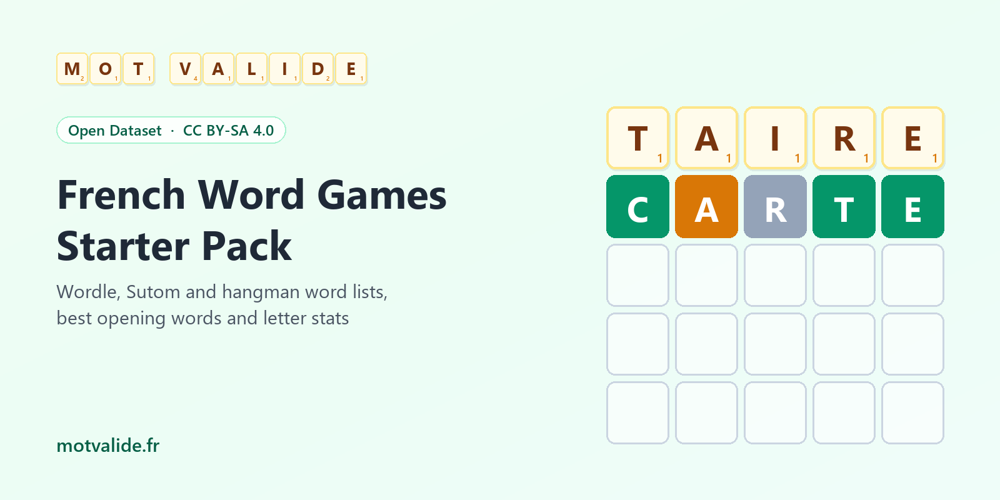

# French Wordle, Sutom And Hangman Word Lists



Ready-to-use French word lists for word games. Answers and accepted guesses for a **French Wordle**, 6 to 9-letter words for **Sutom** and **Motus**, levelled nouns for **hangman** (le pendu), the **best opening words**, and letter-by-position statistics. Plain CSV, UTF-8, CC BY-SA 4.0.

Every word is a valid French Scrabble word according to [Mot Valide](https://www.motvalide.fr/) and appears in real French usage.

**Best common opening word for a French Wordle: `TAIRE`**, which leaves about 34 of 1,324 answers on average, ahead of `CARTE` and `CRAIE`.

## Files

| File | Rows | Use it for |
|---|---|---|
| [`data/wordle_fr_answers.csv`](data/wordle_fr_answers.csv) | 1,324 | Daily answers, 5-letter words players know |
| [`data/wordle_fr_guesses.csv`](data/wordle_fr_guesses.csv) | 6,083 | Every 5-letter word the game should accept |
| [`data/sutom_words.csv`](data/sutom_words.csv) | 62,496 | 6 to 9-letter words with first letter and answer flag |
| [`data/hangman_words.csv`](data/hangman_words.csv) | 6,668 | Common nouns of 4 to 12 letters, easy, medium or hard |
| [`data/best_openers.csv`](data/best_openers.csv) | 250 | Best opening words for Wordle, and for Sutom by length and first letter |
| [`data/letter_position_stats.csv`](data/letter_position_stats.csv) | 910 | Share of each letter at each position, lengths 5 to 9 |

Words come in their board spelling (uppercase, no accents) with the usual written spelling next to it (`taire`, `rôtie`, `désire`).

## Quick Start

**Python**

```python
import pandas as pd

base = "https://raw.githubusercontent.com/verbarium/french-word-games/main/data/"
answers = pd.read_csv(base + "wordle_fr_answers.csv", keep_default_na=False)
guesses = set(pd.read_csv(base + "wordle_fr_guesses.csv", keep_default_na=False).word)

secret = answers.sample(1).word.item()
print(secret, "TAIRE" in guesses)
```

**JavaScript**

```js
const base = "https://raw.githubusercontent.com/verbarium/french-word-games/main/data/";
const text = await (await fetch(base + "wordle_fr_answers.csv")).text();
const answers = text.trim().split("\n").slice(1).map(line => line.split(",")[0]);
const secret = answers[Math.floor(Math.random() * answers.length)];
```

**Hugging Face**

```python
from datasets import load_dataset
answers = load_dataset("verbarium/french-wordle-sutom-word-lists", "wordle_answers", split="train")
```

## How The Lists Are Built

- **Validity** comes from the word list behind [Mot Valide](https://www.motvalide.fr/), a free French Scrabble word checker.
- **Frequency** comes from [wordfreq](https://github.com/rspeer/wordfreq) (Robyn Speer, CC BY-SA 4.0). Only words seen in real French text are kept.
- **Answers** are common nouns, adjectives and verb infinitives in the singular, picked with [Lexique 3.83](http://www.lexique.org/) (Boris New and Christophe Pallier, CC BY-SA 4.0), with a Zipf frequency of 3 or more. Words tagged vulgar or offensive in the French Wiktionary are left out.
- **Best openers** are ranked by expected information against every answer, with Wordle rules for repeated letters.

Full documentation, patterns and a starter notebook are on [Kaggle](https://www.kaggle.com/datasets/cuivrax/french-word-games-starter-pack) and [Hugging Face](https://huggingface.co/datasets/verbarium/french-wordle-sutom-word-lists).

## License And Credit

[CC BY-SA 4.0](https://creativecommons.org/licenses/by-sa/4.0/), like its sources. Please credit **"Mot Valide (motvalide.fr), with Lexique 3.83 and wordfreq"**.

Wordle, Sutom, Motus and Scrabble are trademarks of their respective owners. This project is independent and not affiliated with them.

---

**En français.** Listes de mots prêtes à l'emploi pour créer un Wordle, un Sutom ou un jeu du pendu en français, avec les meilleurs mots d'ouverture (TAIRE en tête) et des statistiques de lettres. Tous les mots sont valides au Scrabble selon [Mot Valide](https://www.motvalide.fr/), où vous pouvez vérifier n'importe quel mot, sa définition et ses anagrammes.
